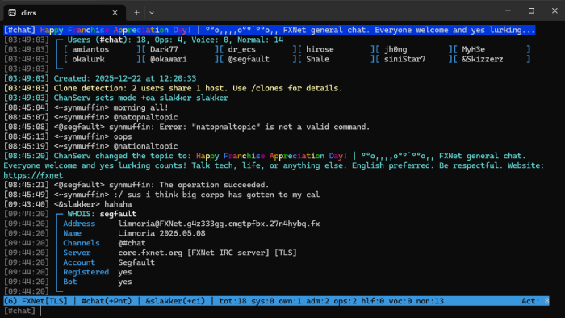
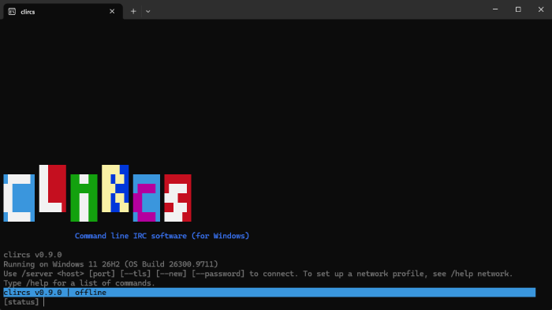
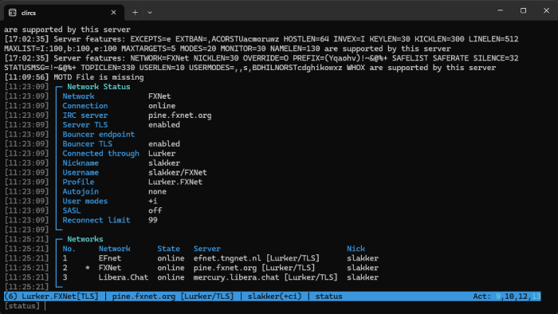

# clircs

Command line IRC software (for Windows)



clircs is a traditional terminal IRC client written in C# for .NET 10. It runs in Windows Console without needing WSL or Cygwin underneath it.

It is also designed to be useful out of the box. I've always disliked what I've come to call "the WordPress approach," where you get supposedly amazing software, but it doesn't do much until you install a bunch of other shit. Yes, the beauty of IRC is that it's decentralized and extensible and customizable. That's why I love it. But two things can exist at the same time, and in this case, the other thing is that some people just want to chat without learning how to script or any of that nerd crap.

Additionally, while clircs does support some IRCv3 capabilities, it's not on board the whole "make IRC into Discord" train that's rolling through. This is "back to basics" territory.

## Current Version

Version 0.9.0 is a preview release, which includes typical (plus additional!) IRC commands, support for multiple networks, TLS, SASL, DCC (and SDCC), bouncer connectivity, channel management, flood protection, logging, and you can add your own scripts by way of Jint (JavaScript).

## Installing

clircs runs on 64-bit Windows 10 or 11. The packaged release comes as a ZIP in both the self-contained and framework-dependent variety, or you can build it yourself from source.

### Get the Packaged Release

- **Self-contained (`clircs-v0.9.0-win-x64-self-contained.zip`):** The bigger download, with .NET 10 included. You don't have to install .NET separately, meaning this is the one to grab if you just want to run clircs.
- **Framework-dependent (`clircs-v0.9.0-win-x64-framework-dependent.zip`):** The smaller download. It requires that you install (or have already installed) the [.NET 10 Runtime](https://dotnet.microsoft.com/en-us/download/dotnet/10.0) for Windows x64. You do not need the full Desktop Runtime or the SDK.

[Snag the ZIP](https://github.com/rekkals/clircs/releases/tag/v0.9.0) you need, extract its contents wherever you want, and run `clircs.exe`.

**HEADS UP:** Windows ShitScreen is probably going to complain about it being an unknown publisher. Just click More Info, then Run Anyway. Do NOT disable SmartScreen system-wide on your machine. If it doesn't let you Run Anyway, you can try building clircs from source instead.

### Build From Source

First things first: grab the [.NET 10 SDK](https://dotnet.microsoft.com/en-us/download/dotnet/10.0).

Then head over to the [0.9.0 release page](https://github.com/rekkals/clircs/releases/tag/v0.9.0), download **Source code (zip)**, and extract it. Open PowerShell in the extracted folder where `clircs.sln` is located and run:

```
dotnet build clircs.sln -c Release
dotnet run --project src/Clircs.Console/Clircs.Console.csproj -c Release --no-build
```

If you want to take a crack at the latest (and most buggy) development build:

```
git clone https://github.com/rekkals/clircs.git
cd clircs
dotnet build clircs.sln -c Release
dotnet run --project src/Clircs.Console/Clircs.Console.csproj -c Release --no-build
```



## Connecting

Connect to a server with:

```text
/server <host> [port] [--tls] [--new] [--password]
```

Using `--new` opens an additional connection in a new window without disturbing your current connection:

```text
/server irc.efnet.org 9999 --tls --new
```

Before connecting for the first time, use `/set nickname`, `/set username`, and `/set realname` to view and set the identity that'll be displayed on IRC.

You can also configure network profiles, allowing you to connect via SASL and set up multiple server endpoints, with `/network`.

### Bouncers

The following bouncers are compatible with clircs:

+ Lurker
+ ZNC
+ soju
+ shroudBNC
+ IRCCloud



## Help

Use `/help` for a list of commands and `/help <command>` for help with a `<command>`.

## More Info

[DOCUMENTATION](DOCUMENTATION.md) contains detailed user documentation, settings, command notes, and current limitations.

[CONTRIBUTING](https://github.com/rekkals/clircs/blob/main/CONTRIBUTING.md) has guidelines and instructions on how to contribute to the clircs project.

[SCRIPTING](SCRIPTING.md) includes info on adding scripts via Jint.

[VERSIONS](VERSIONS.txt) shows the pre-GitHub-upload version history.

## Licensing

clircs is free software licensed under the GNU General Public License, either version 3 or (at your option) any later version. See [LICENSE](LICENSE).

The license for .NET 10 is in [DOTNET-LICENSE.txt](DOTNET-LICENSE.txt).

Licensing notices for Jint, Acornima, and for .NET's bundled libraries can be found in [THIRD-PARTY-NOTICES](THIRD-PARTY-NOTICES.txt).

## Contact

Report all issues (other than security) via GitHub at: https://github.com/rekkals/clircs/issues

Please send security issues by email: slakker@clircs.org

Visit #clircs on EFnet.
